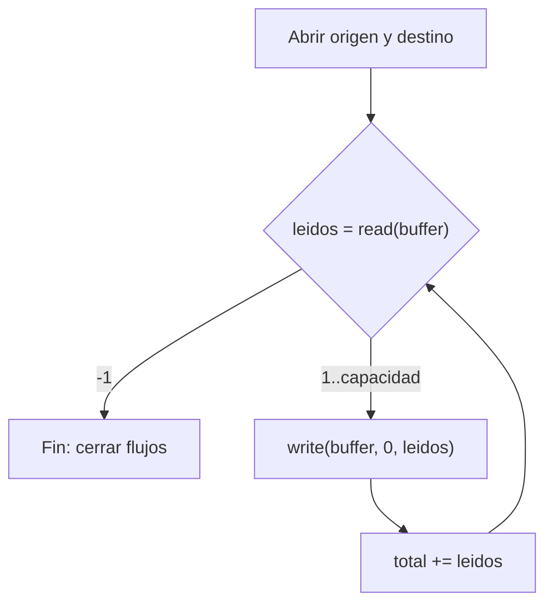

# Teoría · Flujos de bytes

Apartado 2.7 de UT02-A. Ampliación en Obsidian: *AD — Flujos de bytes*.

## Clases del bloque

`InputStream` y `OutputStream` son las clases abstractas de los flujos de bytes.
Para ficheros se usan sus subclases:

| Clase | Constructor | Uso |
|---|---|---|
| `FileInputStream` | `(File)` / `(String)` | Lee bytes de un fichero |
| `FileOutputStream` | `(File)` / `(String)` | Crea o **sobrescribe** el fichero |
| `FileOutputStream` | `(File, true)` / `(String, true)` | **Anexa** al final del fichero |

## Métodos que hay que dominar

| Método | Devuelve / hace |
|---|---|
| `int read()` | Un byte (0–255) o `-1` al final del fichero |
| `int read(byte[] b)` | Cantidad **realmente** leída (1..`b.length`) o `-1` |
| `void write(byte[] b)` | Escribe **todo** el array: `b.length` bytes |
| `void write(byte[] b, int off, int len)` | Escribe `len` bytes desde el índice `off` del array |
| `void close()` | Cierra el flujo y libera el recurso |

- `off` es un **índice del array**, no una posición del fichero.
- `len` es la **cantidad** de bytes que se escriben.
- `-1` indica fin del flujo (EOF). Un `0` no lo es.
- El búfer **no se vacía** entre lecturas: conserva restos de la vuelta anterior.
- `available()` es solo una estimación; no sirve para detectar el final.

## Copia por bloques



## Predice antes de programar

Origen `[1, 2, 3, 4, 5, 6]` y búfer de 4 posiciones. Rellena la tabla:

| Vuelta | `read` devuelve | Contenido del búfer | Bytes a escribir |
|---|---|---|---|
| 1 | ? | ? | ? |
| 2 | ? | ? | ? |
| 3 | ? | — | — |

<details>
<summary>Comprobar la predicción</summary>

| Vuelta | `read` devuelve | Contenido del búfer | Bytes a escribir |
|---|---|---|---|
| 1 | 4 | `[1, 2, 3, 4]` | 4 |
| 2 | 2 | `[5, 6, 3, 4]` | 2 |
| 3 | -1 | — | — (fin) |

En la vuelta 2, las posiciones 2 y 3 todavía guardan `3, 4` de la vuelta
anterior. Con `write(buffer)` el destino tendría 8 bytes:
`[1, 2, 3, 4, 5, 6, 3, 4]`.
</details>

## Cerrar los flujos

Los flujos implementan `AutoCloseable`. Declararlos en `try (...)` garantiza que
se cierren aunque se lance una `IOException`:

```java
try (FileInputStream in = new FileInputStream(origen);
     FileOutputStream out = new FileOutputStream(destino)) {
    // ...
}
```

El ejemplo del temario cierra con `close()` dentro del `try`. Si se produce una
excepción antes, los flujos se quedan abiertos.

## Trampas del ejercicio

- **Destino igual al origen.** `new FileOutputStream(destino)` vacía el fichero
  **al abrirlo**. Si es el mismo que el origen, se pierden los datos antes de
  leerlos. Compara las rutas con `getCanonicalFile()`, porque `a/./x.bin` y
  `a/x.bin` son el mismo fichero.
- **Validar antes de abrir.** Abrir un `FileOutputStream`, incluso en modo
  append, ya crea el fichero. Comprueba `off` y `len` antes de abrir el flujo.

## Comprueba tu comprensión

- ¿Qué devuelve `read(buffer)` la primera vez sobre un archivo vacío?
- ¿Qué argumentos de `write` escriben solo `30` y `40` de `{10, 20, 30, 40}`?
- ¿Por qué el bucle del temario usa `> 0` y el ejercicio `!= -1`? ¿Cambia algo
  con `FileInputStream`?

## El mismo patrón en los ejercicios nuevos

No memorices cinco soluciones diferentes. Reconoce qué cambia en el mismo esquema:

| Ejercicio | Entrada | Qué hacer con los datos | Salida |
|---|---|---|---|
| `guardar` | No hay flujo de entrada: ya tienes un array | Escribir el array completo una vez | Sobrescribir |
| `contarBytes` | Leer por bloques | Sumar la cantidad leída | No hay flujo de salida |
| `contarApariciones` | Leer por bloques | Recorrer la parte válida y contar coincidencias | No hay flujo de salida |
| `anexarArchivo` | Leer por bloques | Escribir la parte válida y sumar lo añadido | Anexar |
| `copiarSustituyendo` | Leer por bloques | Sustituir coincidencias en la parte válida y escribirla | Sobrescribir |

### Dos bucles con trabajos distintos

En los ejercicios 5 y 7 necesitas un bucle de lectura y, dentro, un recorrido
del bloque. El primero avanza por el fichero; el segundo por los bytes que
acabas de leer. El recorrido interior termina en `leidos`, no en la capacidad.

No necesitas un array nuevo por cada vuelta ni limpiar el que tienes.
En la copia con sustitución, cambiar el búfer no cambia el fichero de origen:
lo abriste para leer, y los bytes transformados se escriben en otro fichero.

### Predice antes de implementar

1. Guardas `[1, 2, 3]` sobre un fichero con `[9, 9, 9, 9, 9]`. ¿Quedan restos?
2. Lees un fichero de 6 bytes con capacidad 4. ¿Qué sumas en cada vuelta?
3. Buscas `7` en `[7, 2, 7, 4, 5]` con capacidad 4. ¿Por qué no recorrer todo el búfer?
4. Añades `[1, 2, 3]` a `[9]`. ¿Qué contiene el destino? ¿Qué total devuelve el método?
5. Copias `[7, 2, 7, 4, 5]` cambiando `7` por `9`. ¿Qué contiene cada fichero al terminar?

Al probarlos, incluye un fichero vacío y una última lectura parcial.
Un byte de valor `0` es un dato normal: no indica fin del fichero.

## Alcance

Solo `java.io`: `FileInputStream` y `FileOutputStream`. No se usan
`Files.copy`, `readAllBytes` sobre el origen ni NIO.

## Ejemplo binario y pistas adicionales

`FileInputStream` y `FileOutputStream` son flujos concretos de entrada/salida.
`InputStream` y `OutputStream` son sus clases abstractas. UT02-A §2.7 desarrolla
la copia por bloques. Un archivo binario no debe interpretarse como texto.

```text
Origen:       [0, 1, 2, 3, 4, 255]     búfer: 4 posiciones
read #1 → 4  buffer = [0, 1, 2, 3]     write(buffer, 0, 4)
read #2 → 2  buffer = [4,255,2,3]      write(buffer, 0, 2)
read #3 → -1                           terminar, NO escribir
Destino:      [0, 1, 2, 3, 4, 255]
```

Las posiciones sobrantes conservan valores anteriores. `off` es el índice inicial
del array y `len` es una cantidad, no el índice final ni una posición del archivo.
`read()` sin array devuelve un byte como `int` 0–255, o -1. `available()` no
sustituye el criterio de fin de lectura.

`new FileOutputStream(destino)` sobrescribe; con `true` añade al final.
`try-with-resources` cierra incluso si hay errores. No captures una excepción
para devolver un total ficticio: propaga `IOException`, permitido en el tema.

<details><summary>Pista 1 · Orden de trabajo</summary>

Valida la capacidad antes de crear el array. Abre entrada y salida en el mismo
try-with-resources. Necesitas un `int` para la lectura y un `long` para el total.

</details>
<details><summary>Pista 2 · Bucle</summary>

El patrón es `while ((leidos = in.read(buffer)) != -1)`. Dentro, escribe solo
`leidos` bytes y súmalos al total. No conviertas el array a `String`.

</details>
<details><summary>Comprobación y variante</summary>

Para 6 bytes y búfer de 3: lecturas 3, 3, -1. El total sigue siendo 6.
Para vacío: la primera lectura es -1, el total es 0 y el destino debe quedar vacío.

</details>
