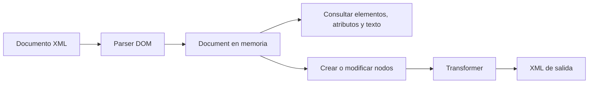
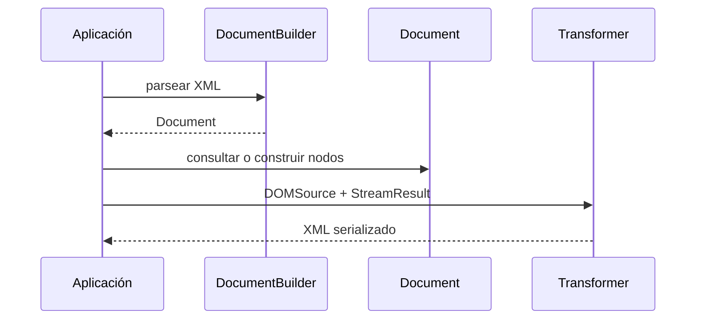

# Teoría · DOM en Java

## XML representado como árbol

DOM construye en memoria un árbol que representa el documento completo. El árbol
permite consultar elementos, atributos y texto, y también añadir o modificar
nodos antes de volver a serializar el documento.

## Nodos relevantes

- `Document` representa el documento entero y permite crear elementos y nodos de
  texto.
- `Element` representa una etiqueta y sus atributos.
- `NodeList` representa los nodos encontrados por una consulta; se recorre por
  índice.
- El texto de un elemento se obtiene desde el nodo correspondiente, no del
  nombre de la etiqueta.
- `Attr` representa un atributo asociado a un elemento.

El elemento raíz se obtiene desde `Document`. Una consulta de elementos puede
devolver varios resultados en orden documental; por eso el enunciado distingue
entre contar todas las coincidencias y recuperar la primera.

## Parsear, consultar y transformar

`DocumentBuilderFactory` permite obtener un `DocumentBuilder`, que parsea la
entrada y devuelve un `Document`. Para guardar el árbol como XML se conecta un
`DOMSource` con un `StreamResult` mediante `Transformer`.

La práctica básica usa documentos locales conocidos como los del tema. No se
exige rechazar `DOCTYPE` ni configurar un `ErrorHandler` especial. El helper de
seguridad ya escrito se conserva como ampliación, no como requisito. El XML mal
formado se comunica como fallo, no como un documento vacío. En tus métodos de
cadena puedes envolver la causa en RuntimeException; el taller con File permite
propagar las excepciones comprobadas, como los ejemplos docentes.

## Crear XML sin concatenar etiquetas

Para crear un documento se construye un `Document`, se crean elementos y nodos de
texto, y se conectan al padre mediante el árbol. Un `Transformer` convierte el
árbol a texto y se ocupa del escape XML del contenido. Esto evita tener que
escapar manualmente `&`, `<` y `>` al construir el XML.

## Qué comprueban los tests

| Método del ejercicio | Caso observado |
|---|---|
| `contarElementos` | Conteo de etiquetas existentes y ausentes |
| `obtenerAtributo` | Primer resultado, atributo ausente y etiqueta ausente |
| `textoPrimero` | Primer elemento en orden documental |
| `raizCoincide` | Coincidencia y discrepancia de raíz |
| `contarNodosElemento` | Conteo que incluye la raíz |
| `crearDocumento` | Árbol transformado y contenido escapado |
| Errores de parseo | XML mal formado comunicado como fallo |

Continúa con [el taller de archivos y navegación](taller-dom.md). Allí se
explican `normalize()`, los nodos de indentación y el ciclo modificar/guardar.

## Comprueba tu comprensión

- ¿Qué ventaja da guardar el documento completo en un árbol `Document`?
- ¿Qué diferencia hay entre leer el texto de un `Element` y leer su atributo?
- ¿Qué adaptadores conectan el árbol DOM con la salida del `Transformer`?

## Apartado del temario

Esta teoría se limita a parseo y creación de DOM, consultas del árbol y escritura
con `Transformer`. No incluye SAX, StAX, JAXB ni XML con Jackson.
